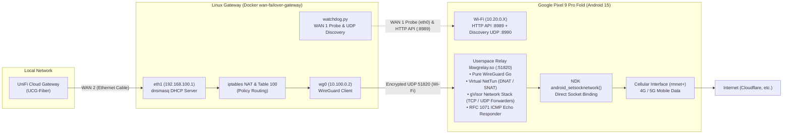

# Cellular WAN Failover

Automated, invisible network backup gateway (**Failover WAN 2**) for **UniFi Cloud Gateway (UCG-Fiber)** using an unrooted Android smartphone connected via Wi-Fi to route local network traffic out through its mobile connection (LTE/5G) without root, without Wi-Fi hotspot tethering, without disconnecting the phone from local Wi-Fi, and **without using Android's `VpnService` API** (zero VPN permission dialogs and zero 🔑 key icon in the Android status bar).

---

## 1. Architecture Overview



### Key Technical Highlights
* **Zero VpnService** : WireGuard relay compiled as a native C/Go shared library (`libwgrelay.so`) running completely in userspace. Zero VPN permission prompts and zero key icon in the Android status bar.
* **Zero SOCKS5 / tun2socks** : Pure WireGuard architecture end-to-end delivering optimal throughput and supporting IP, UDP (DNS), and ICMP (UniFi health check pings).
* **Forced Cellular Outbound** : Outbound internet sockets are bound directly to the active cellular network handle using NDK `android_setsocknetwork(netHandle, fd)`. The smartphone remains connected to local Wi-Fi.
* **Android 15 (ARM64) 16 KB Page-Size Compliant** : Native binary built with 16 KB ELF page alignment (`-Wl,-z,max-page-size=16384`) verified via `zipalign`.
* **Power Efficiency** : By default (*On demand* standby), cellular data and the WireGuard relay remain dormant (`idle`) during normal operation. They are awakened by the gateway only when WAN 1 fails.
* **Hot Standby (optional)** : A phone that stays on its charger (e.g. an old phone) can offer an always-on tunnel instead, so the router sees WAN 2 online at all times, monitors it, and switches over without waiting for the gateway (see [Hot standby](#7-hot-standby-always-on-backup-wan)).
* **Complete Host Isolation** : Everything runs inside an all-in-one Alpine Docker container using `--network host`. No packages installed on the host OS.

---

## 2. Repository Structure

```text
mobile-wan-backup/
├── .devcontainer/             # Containerized dev environment (Java 21, Android SDK 35/36, NDK r28, Go 1.24)
├── android/                   # Native Android application (Kotlin Compose + Go C-Shared relay)
│   ├── app/                   # Kotlin app (Ktor HTTP :8989, Discovery :8990, Compose UI)
│   ├── wgrelay/               # Userspace WireGuard relay in Go (gVisor, DNAT/SNAT, NDK bind)
│   └── build_wgrelay.sh       # NDK arm64 build script (16 KB page alignment)
└── gateway/                   # All-in-one failover gateway under Docker
    ├── Dockerfile             # Alpine image (dnsmasq, wireguard-tools, iptables, python3)
    ├── docker-compose.yml     # Docker host service with cap_add NET_ADMIN
    ├── .env.example           # Centralized environment configuration template
    ├── entrypoint.sh          # Container entrypoint (auto-ip, internal dnsmasq, watchdog)
    ├── watchdog.py            # WAN 1 monitoring and automatic failover daemon
    └── wanctl                 # CLI control utility (installed in the image as `wanctl`)
```

---

## 3. Network Topology & Addressing

| Segment | Interface | Role | IP Addressing |
| :--- | :--- | :--- | :--- |
| **Local LAN** | `eth0` (Pi) & Wi-Fi | Local network & WAN 1 | `10.20.0.0/24` (Default gateway) |
| **UniFi WAN 2 Link** | `eth1` (Pi <-> UCG) | Direct Ethernet cable | Pi: `192.168.100.1` / UniFi: `192.168.100.10` (DHCP) |
| **WireGuard Tunnel** | `wg0` | Encrypted tunnel over Wi-Fi | Phone: `10.100.0.1` / Pi: `10.100.0.2` (UDP `51820`) |
| **Cellular WAN** | `rmnet+` (Android) | Cellular backup outbound | Public IP assigned by mobile carrier |

---

## 4. Deployment Guide

### Step 1: Android Application (`android/`)

1. **Enable Wireless Debugging** on the smartphone (*Settings > Developer Options > Wireless Debugging*).
2. **Connect ADB** :
   ```bash
   adb connect <PHONE_IP>:<ADB_PORT>
   ```
3. **Build Native Relay & APK** :
   ```bash
   bash android/build_wgrelay.sh
   cd android && ./gradlew assembleDebug
   adb install -r app/build/outputs/apk/debug/app-debug.apk
   ```
4. **Launch Application** :
   * Open the app on the phone. The *Foreground Service* starts with an ongoing persistent notification.
   * In Android settings for the app, set Battery usage to **Unrestricted**.

### Step 2: Gateway Deployment (`gateway/`)

#### Option A: Deploy with repository directory
1. **Copy `gateway/` directory** to the gateway host (e.g. `~/wan-failover`).
2. **Configure Environment** (optional if using defaults):
   ```bash
   cd ~/wan-failover
   cp .env.example .env
   ```
3. **Start Docker container** (or build locally with `--build`):
   ```bash
   docker compose up -d
   ```
4. **Pair the phone** (see Step 3).

#### Option B: Deploy with standalone `compose.yaml` (No Git clone needed)
Create `compose.yaml` on the host:
```yaml
services:
  wan-failover-gateway:
    image: ghcr.io/tichael/cellular-wan-gateway:latest
    container_name: wan-failover-gateway
    restart: unless-stopped
    network_mode: host
    cap_add:
      - NET_ADMIN
      - NET_RAW
    environment:
      - PRIMARY_IFACE=eth0
      - FAILOVER_IFACE=eth1
      - FAILOVER_GATEWAY_IP=192.168.100.1
      - FAILOVER_CIDR=24
      - FAILOVER_AUTO_CONFIGURE_IFACE=true
      - FAILOVER_DHCP_ENABLED=true
      # - FAILOVER_DHCP_RANGE_START=192.168.100.10  # Optional (auto-derived from FAILOVER_GATEWAY_IP if omitted)
      # - FAILOVER_DHCP_RANGE_END=192.168.100.20    # Optional (auto-derived from FAILOVER_GATEWAY_IP if omitted)
      - FAILOVER_DHCP_LEASE_TIME=12h
      - FAILOVER_DNS_SERVERS=1.1.1.1,1.0.0.1
      - ROUTING_TABLE_ID=100
      - WG_IFACE=wg0
      - CLAMP_MSS=true
      - PING_TARGETS=1.1.1.1 8.8.8.8
      - PING_TIMEOUT=2
      - CANARY_IP=198.18.0.1
      - FAIL_THRESHOLD=3
      - RESTORE_THRESHOLD=5
      - CHECK_INTERVAL=5
      - HOT_STANDBY=true   # Always-on tunnel with phones that offer it (see "Hot standby")
    volumes:
      - /lib/modules:/lib/modules:ro
      - gateway-config:/config   # Gateway ID and paired phones

volumes:
  gateway-config:
```
Run: `docker compose up -d`

### Step 3: Pair each phone with the gateway

The gateway only works with phones it is paired with, and every message between them is signed (see [PROTOCOL.md](PROTOCOL.md)). Repeat this for each phone (e.g. every adult in a family):

1. Connect the phone to the Wi-Fi network the gateway is on. The pairing is tied to that network: the app only acts as a relay while connected to it.
2. On the gateway, run:
   ```bash
   docker exec -it wan-failover-gateway wanctl pair
   ```
   It prints a QR code and a `wanfailover://pair?...` link, valid for one phone and 5 minutes.
3. Scan the QR code with the app (**Scan Gateway QR**) or the camera app, or paste the link (**Paste Link**), then confirm.
4. The gateway finishes the pairing over the Wi-Fi network and prints `✓ Paired with '<phone name>'`. Check with `wanctl phones`.

A phone can be paired with several gateways (e.g. home and cottage), each on its own Wi-Fi network. If the Wi-Fi name changes, pair again. To remove a phone, run `wanctl unpair <name>` on the gateway and remove the gateway in the app.

---

## 5. Operations & CLI Utility (`wanctl`)

The gateway image ships with the [`wanctl`](gateway/wanctl) CLI, so nothing needs to be installed on the host. Run it with `docker exec`:

```bash
# Pair a smartphone (QR code), list paired phones, remove one
docker exec -it wan-failover-gateway wanctl pair
docker exec -it wan-failover-gateway wanctl phones
docker exec -it wan-failover-gateway wanctl unpair "<phone name>"

# Check smartphone status, relay state, and transmitted bytes (optionally: wanctl status "<phone name>")
docker exec -it wan-failover-gateway wanctl status

# Discover a paired smartphone on local Wi-Fi via signed UDP beacons (port 8990)
docker exec -it wan-failover-gateway wanctl discover

# Manually trigger cellular failover activation
docker exec -it wan-failover-gateway wanctl start

# Manually stop failover (return smartphone to low-power standby)
docker exec -it wan-failover-gateway wanctl stop

# Test WAN 1 primary probe connectivity (eth0)
docker exec -it wan-failover-gateway wanctl test-probe

# Verify if egress path is direct (WAN 1) or hairpinned (WAN 2)
docker exec -it wan-failover-gateway wanctl test-route

# Tail watchdog container logs in real time
docker logs -f wan-failover-gateway

# Open a shell in the container (wanctl, wg, ip and iptables are available)
docker exec -it wan-failover-gateway bash
```

Optional shortcut on the host: `alias wanctl='docker exec -it wan-failover-gateway wanctl'`

---

## 6. Automated Production Behavior

1. **Continuous Monitoring** : The watchdog continuously monitors WAN 1 (`eth0`) using periodic ICMP pings to `1.1.1.1` and `8.8.8.8`.
2. **Outage Detection** : Upon 3 consecutive ping failures, the watchdog invokes the phone's local HTTP API (`POST /v1/failover/start`). Every request and answer is signed with that phone's pairing secret, and the phone only accepts it on the Wi-Fi network it was paired on ([PROTOCOL.md](PROTOCOL.md)).
3. **Instant Failover** : The Pi generates a fresh WireGuard key pair for this activation and sends only its public key in the start request. The phone activates cellular data and starts its userspace WireGuard relay, keyed to that public key. The phone's HTTP API (`8989`) and relay (`51820`) listen on its Wi-Fi address only, never on the cellular interface. The Pi builds its own `wg0` config from validated fields, brings up `wg0`, sets up Table 100 policy routing, and configures iptables MASQUERADE. The router detects WAN 2 healthy and routes all LAN traffic through it.
4. **Tunnel Canary Verification & Automatic Recovery (Failback)** : While failover is active, the watchdog probes a non-routable benchmark IP (`198.18.0.1`, RFC 2544 / RFC 6890). If LAN default traffic is routed out WAN 2, the phone's WireGuard relay synthesizes replies and the canary succeeds, keeping failover active without flapping. Once primary WAN 1 recovers and the router switches its default route back to WAN 1, the canary times out (ISPs drop `198.18.0.1`). The watchdog then verifies direct internet connectivity via primary WAN 1 (`1.1.1.1`). After 5 consecutive direct successes, the Pi tears down `wg0`, flushes routing tables, and signals the phone to release cellular data (`POST /v1/failover/stop`). A phone in hot standby keeps its tunnel instead (see below).

---

## 7. Hot Standby (Always-On Backup WAN)

On demand (*cold*) failover takes a while: the gateway needs 3 failed probes (15 s) to detect the outage, then brings up cellular and the tunnel, then the router has to notice WAN 2 is online before it switches. In **hot standby**, the tunnel is up before the outage: the router sees WAN 2 online at all times, monitors it, and fails over as soon as it detects that WAN 1 is down.

### On the phone

In the app, choose a **Standby Mode**:

| Mode | Behaviour |
| :--- | :--- |
| **On demand** (default) | Cold standby: cellular starts only during an outage. |
| **Plugged in** | Hot standby while the phone is plugged in; on demand on battery (2 minutes after unplugging). |
| **Always** | Hot standby, even on battery. |

"Plugged in" means connected to power, whether or not it is charging, so it works with a charge limit. For a phone that lives on its charger, turn on its battery protection (e.g. Pixel: *Settings > Battery > Charging optimization > Limit to 80%*) and set its battery usage to **Unrestricted**.

### On the gateway

Nothing to do: hot standby is on by default (`HOT_STANDBY=true`; set it to `false` to only ever use on-demand failover). While a phone offers hot standby, the gateway keeps `wg0`, Table 100 and the NAT rules up:

- **Hot standby**: the router uses WAN 1 and sees WAN 2 online. The gateway checks the tunnel every 5 s (the phone answers those probes itself, so they use no mobile data) and rebuilds it if the phone is lost.
- **Carrying**: the router switched to WAN 2. When WAN 1 is back, the phone returns to hot standby.
- If the phone stops offering hot standby (unplugged, setting changed), the gateway releases it, unless the router is using WAN 2 at that moment: then it keeps the tunnel until WAN 1 is back. On battery, the phone still carries the traffic during an outage.
- If several phones offer hot standby, only one carries the tunnel; another one takes over if it is lost.
- A phone on battery below its minimum battery gets no hot standby tunnel (see "Several phones").

`wanctl phones` shows the standby each phone offers and its battery.

### Several phones

In the app, each phone sets its **Minimum Battery** (default 20%) and whether to **use it below the minimum if no other phone can** (default on). The phone announces these with its battery level and whether it is plugged in. The gateway uses the best phone available: battery not low (plugged in, or at least its minimum), then offering hot standby, then plugged in, then the most battery. A phone low on battery is only used when no other phone can take the failover, and only if that setting is on.

During an outage, the failover moves to another phone when the active one runs low on battery (and another phone is plugged in or has at least 10% more than its own minimum; with the setting off, any phone that isn't low, and without one the phone is released even though the house goes offline), or when a phone offering hot standby shows up while a phone without it carries the outage (e.g. a phone set to *Always* comes home). The new phone starts its relay before the current one is released, so traffic stops only for a second or two, but the new cellular public IP resets open connections. If the new phone doesn't work, the current one keeps the tunnel.

### On the router (UniFi)

- Set WAN 2 to **Failover only**, not load balancing: otherwise part of the LAN traffic goes out over cellular at all times.
- Turn off scheduled speed tests on WAN 2.
- The router's WAN 2 monitoring (pings, DNS checks) now goes out over cellular continuously. It is small, but check the phone's mobile data usage after the first days.


